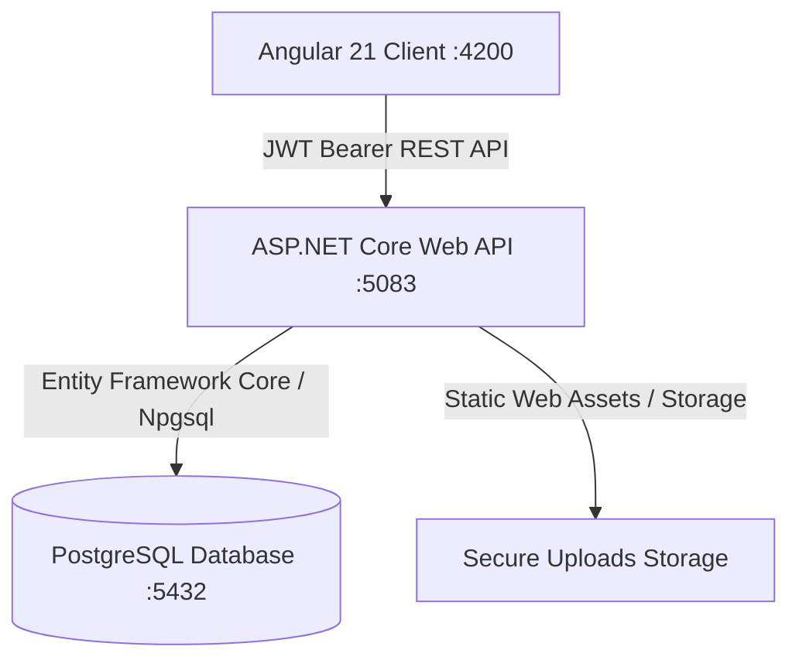

# CRHDRI.AI — Institutional Management Platform


A modern, high-performance, and secure institutional management web application designed for higher education academies. Features dedicated Student and Faculty portals, live KPI computations, attendance analytics, assignment workflows, course material management, and cryptographic role-based access control.

---

## 🌟 Key Features

### 🎓 Student Portal
- **Dashboard & Academics**: Live overall attendance metrics, current CGPA summary, and enrolled courses breakdown.
- **Attendance Analytics**: Subject-wise percentage computations based strictly on conducted sessions.
- **Course Learning Materials**: Real-time PDF material browsing and authorized binary streaming downloads.
- **Assessments & Quizzes**: Strict question secrecy (correct answer keys completely stripped before client delivery).
- **Academic Results**: Marks breakdown, overall percentages, and exam evaluation records.
- **Identity & Security**: Global IDOR middleware ensuring students can only access their authenticated profile and data.

### 👨‍🏫 Faculty Portal
- **Faculty Dashboard**: Live aggregated statistics (total classes assigned, student count, total conducted sessions).
- **Class & Roster Management**: Class-wise student rosters with enrollment data.
- **Attendance Tracking**: Creation, scheduling, and marking of conducted class sessions.
- **Assignment Console**: Task publishing, submission tracking, and secure PDF submission downloading.
- **Course Materials Management**: Multi-format learning material publishing for assigned subjects.
- **Assessment Management**: Creation and administration of quizzes and evaluations.

---

## 🏗️ System Architecture



---

## 💻 Tech Stack

- **Backend**: ASP.NET Core Web API (.NET 10), C#
- **ORM / Database Driver**: Entity Framework Core 10, Npgsql
- **Database**: PostgreSQL
- **Frontend**: Angular 21 (Standalone Components, Signals, Reactive Forms, SCSS)
- **Authentication**: JWT Bearer Tokens with cryptographic role claim authorization (`STUDENT`, `FACULTY`)
- **Security**: Strict Cross-Origin Resource Sharing (CORS), anti-IDOR middleware, secure password hashing

---

## 🚀 Getting Started

### Prerequisites
- [.NET 10 SDK](https://dotnet.microsoft.com/)
- [Node.js (v20+)](https://nodejs.org/) & `npm`
- [PostgreSQL](https://www.postgresql.org/) (running locally on default port `5432`)

---

### 1. Database Setup
Ensure PostgreSQL is active and create the database:
```sql
CREATE DATABASE crhdri_institution_db;
```

Configure connection string in .NET user-secrets or `appsettings.json`:
```json
{
  "ConnectionStrings": {
    "DefaultConnection": "Host=localhost;Port=5432;Database=crhdri_institution_db;Username=postgres;Password=YOUR_PASSWORD"
  }
}
```

---

### 2. Backend Setup (`CRHDRI.API`)
```bash
cd CRHDRI.API
dotnet restore
dotnet build
dotnet run --launch-profile http
```
The API server will listen on `http://localhost:5083`.

---

### 3. Frontend Setup (`crhdri.frontend`)
```bash
cd crhdri.frontend
npm install
npm start
```
The client application will be available at `http://localhost:4200`.

---

## 🔑 Demo Credentials

| Role | Username / Identifier | Password |
| :--- | :--- | :--- |
| **Student** | `STU-DEMO-001` | `DemoStudent@2026` |
| **Faculty** | `demo.faculty@crhdri.ai` | `DemoFaculty@2026` |

---

## 🔒 Security Compliance
- **Zero Mock Fallbacks**: All metrics, rosters, and KPIs are computed directly from database tables.
- **Role Isolation**: Faculty endpoints strictly enforce `FacultyOnly` policies; student endpoints enforce URL-to-token enrollment parity.
- **Assessment Secrecy**: Question payloads omit answer keys to prevent client-side inspection.

---

## 📄 License
This project is proprietary and confidential to **CRHDRI.AI**.
